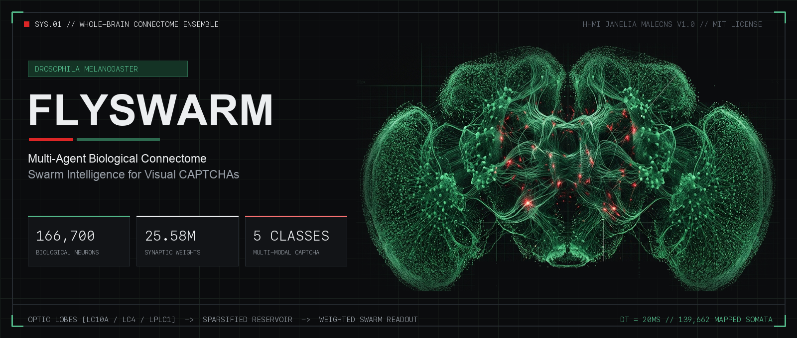
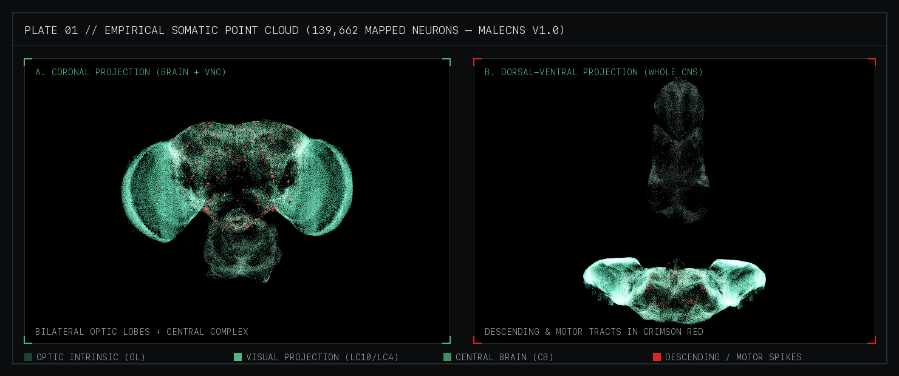
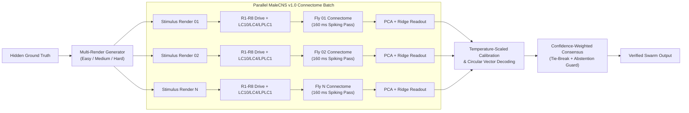
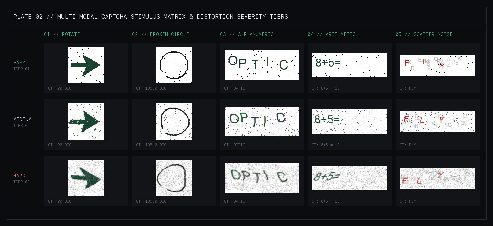

<div align="center">



# FLYSWARM

**Multi-Modal Visual CAPTCHA Resolution via Confidence-Weighted Ensemble Consensus over the Whole-Brain Biological Connectome of *Drosophila melanogaster***

[](https://www.python.org/)
[](https://nextjs.org/)
[](https://threejs.org/)
[](https://male-cns.janelia.org/)
[](#biological-architecture)
[](#biological-architecture)
[](./LICENSE)

[**Overview**](#overview) ·
[**Biological Architecture**](#biological-architecture) ·
[**Stimulus Matrix**](#supported-captcha-modalities) ·
[**Swarm Consensus**](#swarm-consensus-formulation) ·
[**Spatial WebGL Lab**](#spatial-3d-laboratory-interface) ·
[**Quickstart**](#quickstart) ·
[**Deployment**](#cloud-deployment)

</div>

---

## Overview

In September 2026, HHMI Janelia Research Campus and Google FlyEM released **MaleCNS v1.0** — the complete electron-microscopy synaptic reconstruction of an adult male fruit fly's central nervous system comprising **166,700 biological neurons** and **25,582,938 directed chemical synapses** across the bilateral optic lobes, central brain, and ventral nerve cord (VNC).

**FlySwarm** investigates reservoir computing and perceptual ensemble consensus on top of this frozen biological connectome:

1. A single biological connectome viewing a heavily warped or salt-and-pepper-corrupted CAPTCHA stimulus exhibits noisy downstream spike trajectories and elevated single-trial error rates.
2. When an ensemble of $N$ simulated connectomes observes **independently perturbed renders** of the same underlying challenge, each fly's photoreceptors and lobula projection neurons (`LC10a/b`, `LC4`, `LPLC1`) project through the 25.58M-synapse graph into trained downstream linear/ridge readouts.
3. Pooling individual agent predictions via calibrated confidence-weighted voting (or circular vector averaging for continuous angular targets) suppresses idiosyncratic distortion noise and recovers ground-truth answers with substantial accuracy gains over the single-fly baseline.

---

## Biological Architecture

<p align="center">
  
</p>

Unlike conventional artificial convolutional or transformer backbones trained end-to-end by backpropagation, FlySwarm preserves the **unmodified biological synaptic graph** as a fixed physical reservoir:

| Structural Parameter | Empirical Specification | Role in FlySwarm |
| :--- | :--- | :--- |
| **Total CNS Neurons** | `166,700` neurons | Full MaleCNS v1.0 biophysical spiking simulation (`dt = 20 ms`, `8` integration steps = `160 ms`) |
| **3D Mapped Somata** | `139,662` classified coordinates | Real-time WebGL somatic point cloud (`8 nm` EM voxel registration, `positions.f32.bin`) |
| **Synaptic Graph** | `25,582,938` weighted connections | Exact neurotransmitter polarity and synaptic multiplicity from Janelia MaleCNS v1.0 |
| **Sensory Drive** | `R1–R6` luminance + `R7/R8` opponency | Spatial luminance strip (`64` channels) + chromatic red-green contrast pre-filtering |
| **Visual Projection** | `LC10a/b`, `LC4`, `LPLC1` | Bilateral horizontal/vertical gradient and quadrant contrast injection past the lamina |
| **Readout Populations** | `descending_neuron`, `cb_intrinsic` | Cross-validated PCA + Ridge linear decoders fitted strictly on downstream spike traces |

---

## System Pipeline



---

## Supported CAPTCHA Modalities

<p align="center">
  
</p>

Each challenge modality uses a domain-appropriate sensory encoding and downstream decoding head:

| Modality | Challenge Task | Sensory Encoding | Readout & Aggregation Strategy |
| :--- | :--- | :--- | :--- |
| **`rotate`** | Classify orientation angle ($0^\circ, 90^\circ, 180^\circ, 270^\circ$) | Omnidirectional luminance + directional lobula gradients | 4-class calibrated ridge readout · Confidence-weighted majority vote |
| **`broken_circle`** | Localize annulus gap angle ($\theta \in [0^\circ, 360^\circ)$) | Spatial ring projection | 2-D $(\sin\theta, \cos\theta)$ central-complex population vector · Weighted circular mean ($\pm 15^\circ$ tolerance) |
| **`text`** | Decode warped 5-character alphanumeric strings | 64-channel horizontal photoreceptor luminance strip | Multi-class reservoir readout · Weighted consensus with max-confidence tie-break |
| **`math`** | Evaluate distorted arithmetic expressions (`a + b =`, `a - b =`) | Photoreceptor strip + spatial quadrant projection | Calibrated expression readout · Confidence-weighted vote |
| **`scatter`** | Isolate target characters from dense clutter | Chromatic `R - 0.5(G + B)` opponency pre-filter | Foreground classification readout · Confidence-weighted vote |

---

## Swarm Consensus Formulation

For discrete classification modalities (`rotate`, `text`, `math`, `scatter`), raw continuous ridge logits $\mathbf{z}_i \in \mathbb{R}^C$ for agent $i \in \{1, \dots, N\}$ are mapped to calibrated class probabilities via temperature-scaled softmax ($\tau = 0.25$):

$$p_{i,c} = \frac{\exp(z_{i,c} / \tau)}{\sum_{k=1}^{C} \exp(z_{i,k} / \tau)}, \qquad w_i = \max_{c} p_{i,c}$$

The ensemble decision aggregates probability mass weighted by each agent's peak certainty $w_i$:

$$\hat{y}_{\text{swarm}} = \arg\max_{c} \sum_{i=1}^{N} w_i \cdot p_{i,c}$$

For continuous angular localization (`broken_circle`), arithmetic averaging fails across the $0^\circ / 360^\circ$ boundary. FlySwarm decodes each fly's $(\sin\hat{\theta}_i, \cos\hat{\theta}_i)$ population vector and computes the confidence-weighted circular mean:

$$\hat{\theta}_{\text{swarm}} = \operatorname{atan2}\!\left(\sum_{i=1}^{N} w_i \sin\hat{\theta}_i,\; \sum_{i=1}^{N} w_i \cos\hat{\theta}_i\right) \bmod 360^\circ$$

### Explicit Edge-Case Guards
* **Single-Fly Baseline ($N = 1$)**: Degrades cleanly to single-agent inference without special-case branching, enabling direct $N=1$ vs. $N \in \{2, 3, 5, 8\}$ ablation.
* **Vote Ties**: Resolved deterministically in favor of the single highest-confidence fly (`had_tie = true` surfaced in UI telemetry).
* **Low-Confidence Abstention**: Emits `UNSOLVED` (`ABSTAINED`) whenever ensemble certainty or circular vector coherence falls below threshold.
* **Rotational Symmetry Detection**: Automatically flags near-180°-symmetric `rotate` stimuli (`near_symmetric = true`).

---

## Spatial 3D Laboratory Interface

The web client (`frontend/`) is architected with **Next.js 16**, **React 19**, **Three.js / React Three Fiber**, and **Tailwind CSS v4** around a disciplined **Charcoal Black (`#0B0C0E`) · Forest Green (`#1B4332` / `#52B788`) · Crimson Red (`#DC2626`)** spatial-brutalist design language:

* **Grounded *Drosophila* Ensemble Station**: Up to 8 anatomically modeled *Drosophila melanogaster* specimens stationed around a tilted 3D stimulus console with tactile tarsal bridges.
* **Live 139,662-Soma Connectome Hologram**: Real-time WebSocket streaming illuminates sensory spikes in bioluminescent Forest Emerald and descending/motor command spikes in Crimson Red, with per-agent (`01`–`08`) and merged ensemble trace inspection.
* **Biophysical Telemetry HUD**: Displays step-by-step integration progress (`160 ms`), live `R1–R8` 32-channel photoreceptor drive bars, decided output vs. ground truth, per-fly confidence matrix, and cumulative session Swarm Gain (`+Δ%` over single-fly baseline).
* **Integrated Readout Lab (`<dialog>`)**: Train new PCA + Ridge connectome readouts live over WebSocket (`/ws/train`) and switch between serialized `.pkl` models without leaving the viewport.

---

## Quickstart

### Prerequisites
* **Python 3.10+** (64-bit recommended)
* **Node.js 20+** and `npm`

### 1. Clone Repository

```bash
git clone https://github.com/A-P-S-Bhaidav/fly-swarm-solver.git
cd fly-swarm-solver
```

### 2. Backend Setup

```bash
python3 -m venv .venv
source .venv/bin/activate        # Windows PowerShell: .venv\Scripts\Activate.ps1
pip install -r requirements.txt
```

Verify environment readiness at any time:

```bash
python setup/check_env.py
```

### 3. Frontend Setup

```bash
cd frontend
npm install
cd ..
```

### 4. Launch Full Stack

On **macOS / Linux**:
```bash
./start.sh
```

On **Windows PowerShell**:
```powershell
.\start.ps1
```

Or run the two services in separate terminals:

```bash
# Terminal 1 — FastAPI + WebSocket Server (Port 8000)
python -m uvicorn server.app:app --host 0.0.0.0 --port 8000 --reload

# Terminal 2 — Next.js Spatial WebGL Client (Port 3000)
cd frontend && npm run dev
```

Open **[http://localhost:3000](http://localhost:3000)** in your browser (`Space` triggers a swarm trial; `CONSOLE` opens parameters and live readout training).

---

## Training & Verification

### Train Connectome Readouts via CLI

Pre-trained readouts for all 5 modalities (`rotate`, `broken_circle`, `text`, `math`, `scatter`) are included in `models/`. To fit new readouts directly from MaleCNS spike traces:

```bash
# Train a specific modality and distortion tier
python -m server.trainer --type rotate --difficulty medium --n-train 60

# Train all 5 modalities sequentially
python -m server.trainer --train-all --difficulty medium --n-train 80
```

### Run Automated Test Suite

```bash
# Run Python unit, calibration, stream, and FastAPI endpoint tests (33 tests)
pytest -v

# Run Frontend ESLint, TypeScript typecheck, and production Next.js build
cd frontend
npm run lint
npx tsc --noEmit
npm run build
```

---

## Cloud Deployment

FlySwarm splits cleanly into a **Dockerized FastAPI WebSocket Backend** (Koyeb / Render / Railway) and a **Next.js Frontend** (Vercel).

### Backend (Docker / Koyeb)
The root [`Dockerfile`](./Dockerfile) packages Python 3.11, system OpenGL/glib libraries, `requirements.txt`, serialized `models/`, and a built-in `/health` probe binding dynamically to `$PORT` (default `8000`).

### Frontend (Vercel)
Import the repository into Vercel with **Root Directory** set to `frontend` and configure:

| Environment Variable | Example Value | Description |
| :--- | :--- | :--- |
| `NEXT_PUBLIC_API_URL` | `https://your-service.koyeb.app` | Public HTTPS origin of the FastAPI backend |
| `NEXT_PUBLIC_WS_URL` | `wss://your-service.koyeb.app` | Optional explicit WSS origin (auto-derived from `NEXT_PUBLIC_API_URL` if omitted) |

---

## Repository Structure

```text
fly-swarm-solver/
├── assets/                    # High-resolution architectural & connectome plates
├── data/samples/              # Sample multi-render CAPTCHA stimuli
├── eval/                      # Statistical rigor & Wilson CI evaluation metrics
│   └── metrics.py
├── flyswarm/                  # Core biological encoding & ensemble package
│   ├── connectome.py          # MaleCNS v1.0 single & batch forward-pass runner
│   ├── local_captcha_gen.py   # Pure-Python multi-render stimulus generator
│   ├── receptor_encoding.py   # R1-R8 photoreceptor & chromatic opponency encoder
│   └── swarm.py               # Confidence-weighted consensus, tie-break & abstention
├── frontend/                  # Next.js 16 + Three.js Spatial WebGL Laboratory
│   ├── app/                   # App Router, custom SVG/ICO icons, OG card, manifest
│   ├── components/            # FlyArenaScene, FlyBrainHologram, FlyRubikActor, ControlDrawer
│   ├── hooks/                 # Real-time WebSocket inference & training hooks
│   ├── lib/                   # Endpoint normalization utilities
│   └── public/                # 139,662-soma binary connectome & Drosophila GLB model
├── generators/                # Optional Dockerized Laravel CAPTCHA microservices
├── harvest/                   # Dataset harvesting & integrity verification scripts
├── models/                    # Serialized PCA + Ridge connectome readouts (.pkl)
├── server/                    # FastAPI REST + WebSocket streaming backend
│   ├── app.py                 # HTTP endpoints (/health, /models, /captcha/sample) & WS routes
│   ├── inference.py           # Real-time connectome batch stepper & calibrated decoder
│   └── trainer.py             # Spike-trace feature collection & cross-validated fitting
├── setup/                     # Cross-platform environment diagnostics
├── tests/                     # 33-test pytest suite (unit, stream, calibration, REST API)
├── Dockerfile                 # Production container specification with /health probe
├── pyproject.toml             # PEP 621 package metadata & pytest config
├── requirements.txt           # Pinned Python dependencies
├── start.sh                   # macOS / Linux single-command stack launcher
└── start.ps1                  # Windows PowerShell single-command stack launcher
```

---

## Author & Acknowledgments

* **Author & Maintainer**: **Anant Pratap Singh Bhaidav** ([GitHub](https://github.com/A-P-S-Bhaidav/fly-swarm-solver))
* **Connectome Dataset**: HHMI Janelia Research Campus & Google FlyEM — [MaleCNS v1.0](https://male-cns.janelia.org/) (CC-BY)
* **Anatomical Reference**: NeuroMechFly *Drosophila melanogaster* biomechanical mesh

Released under the [MIT License](./LICENSE).
